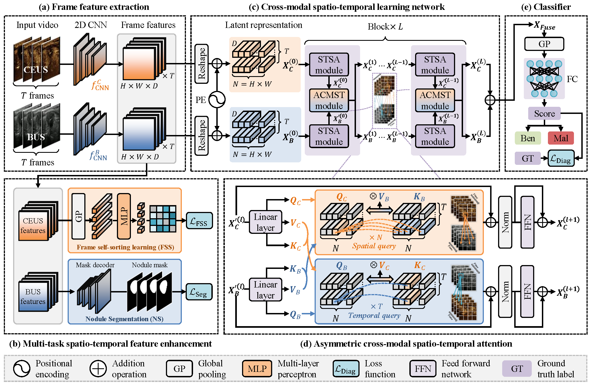

# AsyCMST: Asymmetric Cross-Modal Spatio-Temporal Learning for Multimodal Ultrasound Nodule Recognition

This repository contains the pre-released code for AsyCMST, a method for asymmetric cross-modal spatio-temporal learning applied to multimodal ultrasound nodule recognition. The model leverages both B-mode and Contrast-Enhanced Ultrasound (CEUS) data for improved diagnosis.

## Framework



## Features

- Multimodal ultrasound analysis (B-mode and CEUS)
- Spatio-temporal learning approach
- Asymmetric cross-modal integration
- Paper-aligned CEUS frame self-sorting and optional BUS segmentation supervision

## Data

A subset of the multimodal ultrasound nodule diagnosis dataset can be downloaded from [XJTU-MMUS-subset-20260401.zip (Google Drive)](https://drive.google.com/file/d/1JQtKzFBBRXw9AyCcMGQ64Va-CnmCVmA5/view?usp=drive_link).

Place the downloaded data in the `datasets` directory. The videos are in the `videos` directory, and we extract selected frames from the videos to accelerate data loading during training. The extracted frames are in the `images` directory.

If the downloaded frame archive contains only `ceus_label_selected.csv`, create the
paper's 5:2:3 train/validation/test split first:

```bash
python preprocess/split_dataset.py \
  --input datasets/CEUS_splitted_frames/ceus_label_selected.csv
```

This creates `train_1.csv`, `valid_1.csv`, and `test_1.csv` beside the source CSV.
The bundled AsyCMST configs use `datasets/CEUS_splitted_frames` by default.

The expected directory structure is:

```
datasets/
└── XJTU-MMUS-subset-20260401/
    ├── images/
    │   ├── 0.ben/
    │   │   ├── bus/
    │   │   │   └── TT_119_CEUS_busvid/
    │   │   │       ├── 00000.jpg
    │   │   │       ├── 00001.jpg
    │   │   │       └── ...
    │   │   └── ceus/
    │   └── 1.mal/
    |── videos/
    |   ├── 0.ben/
    │   │   ├── bus/
    │   │   │   |── TT_119_CEUS_busvid.mp4
    │   │   │   |── TT_173_CEUS_busvid.mp4
    │   │   │   └── ...
    │   │   └── ceus/
    │   └── 1.mal/
    |── train_1.csv
    |── valid_1.csv
    └── test_1.csv
```

## Requirements

- Python 3.10+
- PyTorch 2.10+
- Other dependencies (see `requirements.txt` if available, or install via pip)

## Installation

1. Clone this repository:
   ```bash
   git clone https://github.com/HongchengHan/AsyCMST.git
   cd AsyCMST
   ```

2. Install dependencies:
   ```bash
   pip install -r requirements.txt
   ```

## Configuration

Edit the configuration files in the `config/` directory for your setup. Available configs:
- `train_asycmst_bus_ceus.yaml`
- `train_baseline_bus_ceus.yaml`
- `train_transformer_baseline_bus_ceus.yaml`
- `train_tsnet_rx50_bus_ceus.yaml`
- `test_asycmst_bus_ceus.yaml`
- `test_baseline_bus_ceus.yaml`
- `test_transformer_baseline_bus_ceus.yaml`

Mask supervision is disabled by default (`data.use_mask: false`), so datasets without
segmentation annotations work directly. To enable it, set `use_mask: true`. The split
CSV must then contain the column configured by `mask_column` (default `mask_dir`). Each
value is an absolute mask-frame directory or a path relative to
`<root_dir>/<mask_root>`. Mask filenames are sorted and uniformly sampled just like the
BUS/CEUS frames.

The auxiliary loss weights can be adjusted independently under `params`. The default
configuration uses `fss_weight: 0.1` and `seg_weight: 0.4`; increase the FSS weight
toward the paper setting of `0.4` when stronger temporal-order supervision is desired.

The default optimizer is AdamW with a learning rate of `1e-4`, which is stable for
fine-tuning the dual encoders at batch size 8. RMSprop remains available by setting
`optimizer: rmsprop`; use a smaller learning rate when training from scratch and do not
resume a checkpoint whose encoder outputs have already collapsed.

The AsyCMST configuration uses ImageNet-pretrained ResNet-18 encoders and matching input
normalization. Classification weights default to `auto`, which computes inverse-frequency
weights from the training split to reduce majority-class prediction bias.

Each ACMST block uses an independent learnable residual gate for cross-modal features.
`model.cross_gate_init` controls its initial value (default `0.1`), so training begins
close to the modality-specific residual paths and learns the required interaction strength
separately at every layer and direction.

By default, cross attention is enabled only in Transformer layers 4–6. This is controlled
by the zero-based `model.cross_attention_start_layer: 3`: use `0` for all six layers,
`5` for only the final layer, or `6` to disable cross attention entirely.

## Training

Run training from the command line:

```bash
python train.py --config config/train_asycmst_bus_ceus.yaml
```

To diagnose the data and optimization pipeline without Transformer, cross attention,
FSS, or segmentation, train the dual-ResNet late-fusion baseline:

```bash
python train.py --config config/train_baseline_bus_ceus.yaml
```

To isolate temporal Transformer self-attention without cross-modal attention, use the
dual-stream baseline (spatially pooled ResNet frame tokens, two Transformer layers per
modality, CLS-token pooling, and late fusion):

```bash
python train.py --config config/train_transformer_baseline_bus_ceus.yaml
```

For a quick end-to-end smoke test (one train batch and one validation batch):

```bash
python train.py --config config/train_asycmst_bus_ceus.yaml \
  --epochs 1 --batch-size 1 --num-workers 0 \
  --max-train-batches 1 --max-valid-batches 1
```

## Evaluation

Run evaluation/inference from the command line:

```bash
python evaluate.py --config config/test_asycmst_bus_ceus.yaml \
  --checkpoint runs/BUS-CEUS-Cls/<run>/ckpt/best_auc.pth
```

Add `--max-batches 1 --batch-size 1 --num-workers 0` for a quick inference smoke test.

Predictions and metrics are written to `results/` by default. The former notebooks
have been replaced by the maintained `train.py` and `evaluate.py` entry points.
Training saves both `best_loss.pth` and `best_auc.pth` because a model can improve its
ranking performance before its probabilities are calibrated around the 0.5 threshold.

## Models

Pre-trained models are available in the `models/` directory:
- `asycmst.py`: Main AsyCMST model
- `resnet.py`: ResNet backbone
- `tsnet.py`: TSNet model

## Citation

If you use this code, please cite:

```bibtex
@article{HAN2026104127,
  title = {AsyCMST: Asymmetric cross-modal spatio-temporal learning for multimodal ultrasound nodule recognition},
  journal = {Medical Image Analysis},
  volume = {112},
  pages = {104127},
  year = {2026},
  issn = {1361-8415},
  doi = {https://doi.org/10.1016/j.media.2026.104127},
  author = {Hongcheng Han and Zhiqiang Tian and Minghao Wang and Yutong Zhang and Dong Zhang and Qinbo Guo and Jue Jiang and Hui Guo and Shaoyi Du and Juan Wang},
}
```

## License

MIT license
